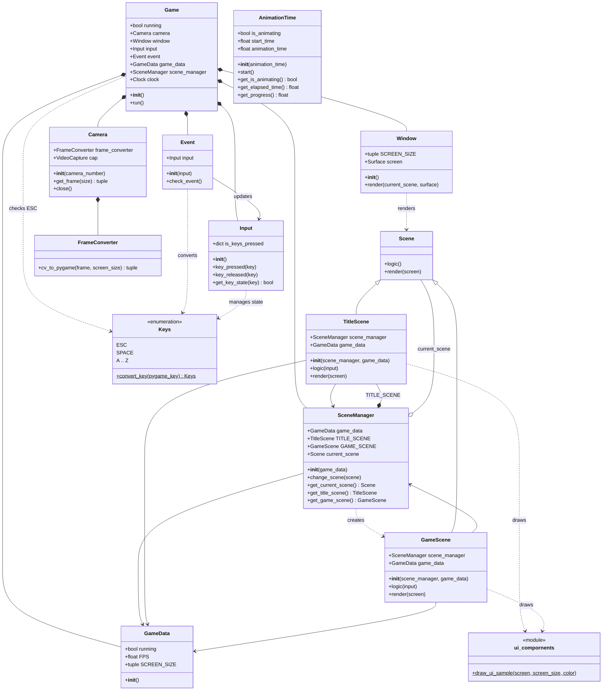
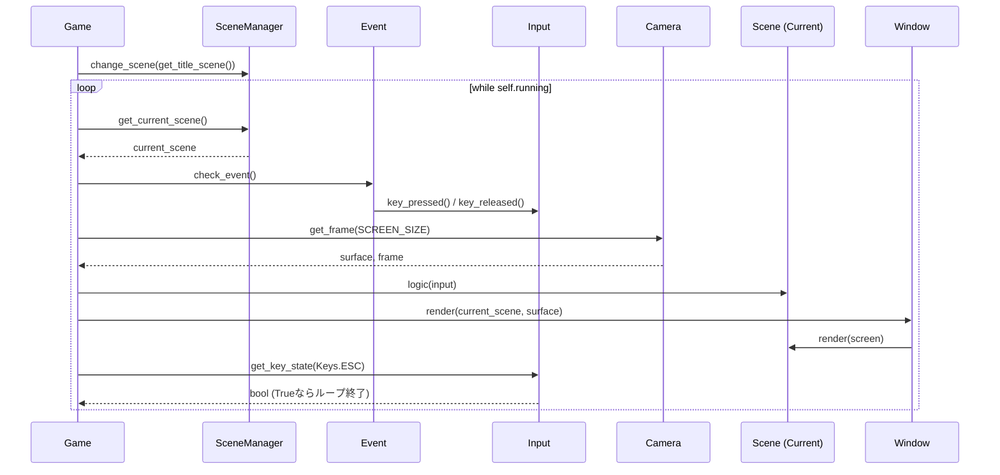

# Pygameカメラ連携ゲームテンプレート設計資料 / Pygame Camera Game Template Design Document  

初回更新日: 2026/11/16(月)  
最終更新日: 2026/11/16(月)  
作成者: norder, Gemini 4 Hydrogen  

`#Python` `#Pygame` `#OpenCV` `#クラス図` `#ゲーム開発`  
`#Python` `#Pygame` `#OpenCV` `#UML` `#ClassDiagram`  


## 1. 概要  

本資料では, `Pygame` と `OpenCV` を組み合わせたゲーム制作テンプレートのクラス構造および利用方法を解説します.  
全14ファイルのモジュール構成とクラス間の依存関係を把握し, 新規シーンやゲームロジックをスムーズに実装できるようになることを目的とします.  


## 2. 前提条件  

### 2.1. 使用ライブラリ  

- `pygame` : ウィンドウ管理, 画面描画, イベント取得, フレームレート制御に使用します.  
- `opencv-python` ( `cv2` ) : Webカメラからの映像取得および画像変換に使用します.  
- Python 標準ライブラリ ( `enum` , `time` , `sys` ) : キー定義, アニメーション時間計測, システム制御に使用します.  

### 2.2. ディレクトリ構成  

各ファイルは `modules` パッケージ配下に配置されている前提です.  

```text
project_root/
└── modules/
    ├── animation_time.py
    ├── camera.py
    ├── event.py
    ├── frame_converter.py
    ├── game.py
    ├── game_data.py
    ├── game_scene.py
    ├── input.py
    ├── keys.py
    ├── scene.py
    ├── scene_manager.py
    ├── title_scene.py
    ├── ui_compornents.py
    └── window.py
```


## 3. クラス図  

テンプレート全体のクラス構成, 継承関係, および依存関係は以下の通りです.  




## 4. モジュール・クラス一覧  

各ファイルの役割を機能グループごとに整理します.  

### 4.1. コア制御  

| ファイル名 | クラス名 | 役割 |
|:---|:---|:---|
| `game.py` | `Game` | 各コンポーネントの初期化とメインループの実行を担うエントリーポイントです. |
| `game_data.py` | `GameData` | `FPS` や `SCREEN_SIZE` など, ゲーム全体で共有する設定値を保持します. |
| `window.py` | `Window` | フルスクリーンウィンドウの生成と, カメラ映像および現在シーンの描画を行います. |

### 4.2. シーン管理  

| ファイル名 | クラス名 | 役割 |
|:---|:---|:---|
| `scene_manager.py` | `SceneManager` | シーンの保持および現在アクティブなシーンの切り替えを管理します. |
| `scene.py` | `Scene` | 全シーン共通のインターフェース ( `logic` , `render` ) を定義する基底クラスです. |
| `title_scene.py` | `TitleScene` | `Scene` を継承したタイトル画面用のシーンテンプレートです. |
| `game_scene.py` | `GameScene` | `Scene` を継承したゲーム本編用のシーンテンプレートです. |

### 4.3. 入力・カメラ・補助機能  

| ファイル名 | クラス・モジュール名 | 役割 |
|:---|:---|:---|
| `event.py` | `Event` | `Pygame` のイベントキューからキーの押下・解放を検知し `Input` に通知します. |
| `input.py` | `Input` | 各キーの現在の押下状態 ( `True` / `False` ) を辞書形式で保持します. |
| `keys.py` | `Keys` | 利用可能なキーの `Enum` 定義と, `Pygame` キーコードからの変換メソッドを提供します. |
| `camera.py` | `Camera` | Webカメラの初期化, フレーム取得, リソース解放を行います. |
| `frame_converter.py` | `FrameConverter` | `OpenCV` の画像を左右反転・RGB変換・リサイズし, `Pygame` の `Surface` に変換します. |
| `animation_time.py` | `AnimationTime` | 指定秒数に対する経過時間や進捗率 ( `0.0` 〜 `1.0` ) を計算するタイマーです. |
| `ui_compornents.py` | `ui_compornents` | 共通のUI描画関数をまとめるモジュールです. |


## 5. メインループの処理フロー  

`Game.run()` を呼び出すと, 最初に `TitleScene` がセットされ, その後 1 フレームごとに以下の順序で処理が実行されます.  




## 6. テンプレートの使い方  

### 6.1. シーン内のロジックと描画の実装  

`TitleScene` や `GameScene` の `logic()` と `render()` に処理を追加します.  
`logic()` には毎フレームの計算や入力判定を記述し, `render()` には `screen` に対する描画処理のみを記述します.  

```python
class GameScene(Scene):
    def __init__(self, scene_manager, game_data):
        self.scene_manager = scene_manager
        self.game_data = game_data

    def logic(self, input):
        # ここに毎フレームの更新処理を記述します
        if input.get_key_state(Keys.SPACE):
            pass

    def render(self, screen):
        # ここに描画処理を記述します
        draw_ui_sample(screen, self.game_data.SCREEN_SIZE, (200, 200, 200))
```

### 6.2. シーンの切り替え  

各シーンは `self.scene_manager` を保持しているため, `logic()` 内から別のシーンへ遷移できます.  

```python
# TitleScene から GameScene へ遷移する例
if input.get_key_state(Keys.SPACE):
    next_scene = self.scene_manager.get_game_scene()
    self.scene_manager.change_scene(next_scene)
```

新しいシーン (例: `ResultScene` ) を追加する場合は, `Scene` を継承したクラスを作成し, `SceneManager` に取得用メソッドを追加します.  

### 6.3. キー入力の判定  

`Input.get_key_state()` に `Keys` 列挙型の値を渡して判定します.  
使用できるキーを増やしたい場合は, `keys.py` の `Keys` と `convert_key()` 内の `keys_map` に追記します.  

### 6.4. アニメーション時間の管理  

フェード演出や時間制限付きの動きを作る場合は, シーン内で `AnimationTime` をインスタンス化して利用します.  

```python
# 2.0秒間のアニメーションを管理する例
anim = AnimationTime(2.0)
anim.start()

# logic() 内で進捗率 (0.0 ~ 1.0) を取得
if anim.get_is_animating():
    progress = anim.get_progress()
```

### 6.5. 共通UIパーツの追加  

複数のシーンで使い回すボタンやゲージなどの描画処理は, `ui_compornents.py` に関数として追加し, 各シーンから呼び出して利用します.  
